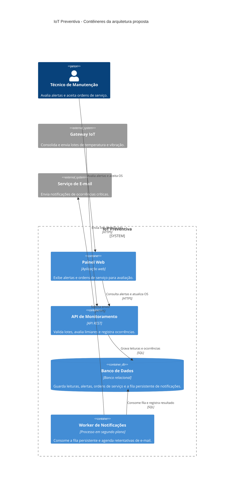

# Auditoria C4 Nível 2 · IoT Preventiva

## Passo 1

1. A gravação depende do banco. Uma falha na única instância, caso a implantação tenha apenas uma, interrompe o registro de leituras, alertas e ordens. O gateway deve reter e reenviar o lote com a mesma identificação. A topologia de implantação continua a confirmar.
2. Enviar e-mail dentro da requisição estenderia a espera do gateway e faria a disponibilidade da ingestão depender do provedor. Na proposta, um worker consome uma fila persistente e reprocessa falhas fora da requisição.
3. A interrupção após a gravação pode deixar o gateway sem confirmação. Uma chave única de lote e a recuperação do resultado já registrado impedem que um reenvio repita o registro crítico.

A fronteira abaixo é uma proposta lógica para o laboratório. A fila de notificações é implementada como uma tabela de outbox no Banco de Dados. O Painel Web consulta os registros por meio da API e é o ponto de aceite da OS pelo técnico.

