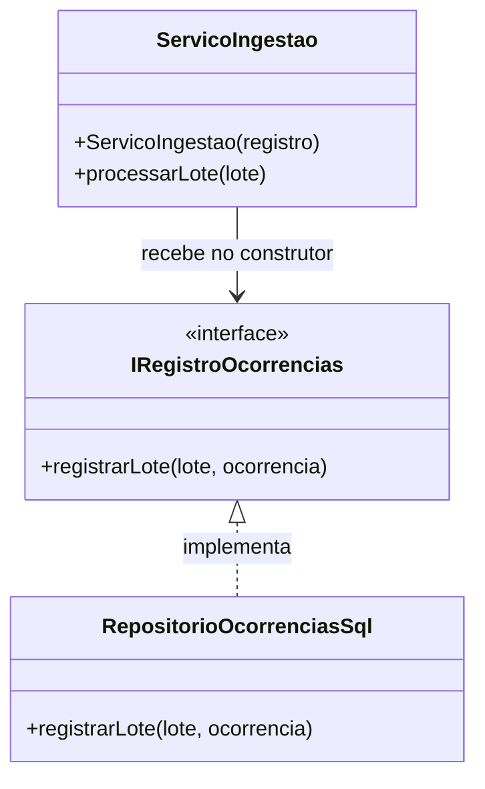

# Classes e interfaces · Ingestão de leituras

Modelo da aplicação proposta. `ServicoIngestao` recebe a interface `IRegistroOcorrencias` no construtor. `registrarLote(lote, ocorrencia)` recebe uma ocorrência opcional para distinguir uma ingestão normal de um desvio crítico confirmado. O contrato permite testar o caso de uso com uma implementação simulada.

