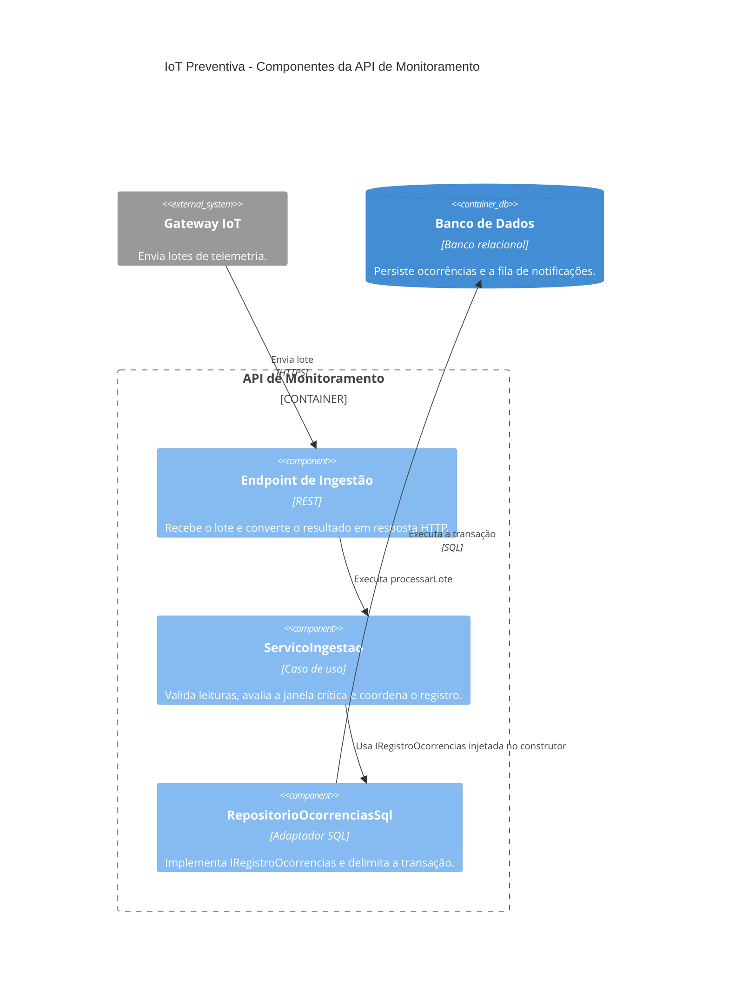

# Componentes da API de Monitoramento · C4 Nível 3

Recorte da ingestão. O caso de uso recebe `IRegistroOcorrencias` por injeção no construtor. A configuração da API vincula o contrato à implementação `RepositorioOcorrenciasSql`.

