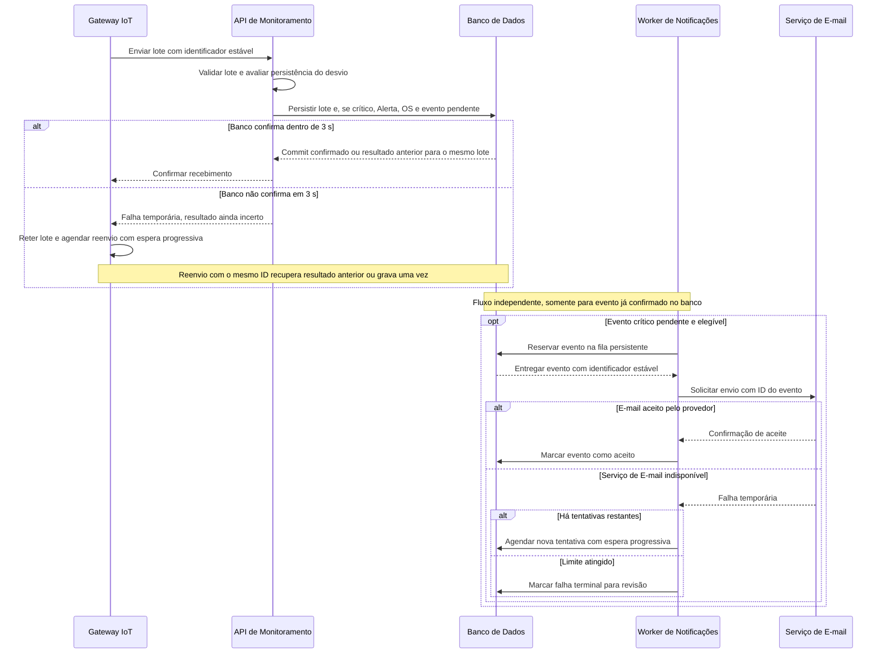

# Sequência resiliente · Ingestão de leituras IoT

## Passo 2

O gateway envia um lote identificado com leituras de temperatura e vibração. A API valida as leituras e verifica se o desvio ultrapassou o limite pelo período exigido. Para um desvio crítico confirmado, o Banco de Dados grava leituras, Alerta, OS em “Aguardando aceite” e evento de notificação na mesma transação. Lotes válidos sem desvio crítico registram somente as leituras.

- **Timeout de 3 s.** É o limite didático de espera da API pelo banco. Um timeout deixa o resultado incerto. A chave do lote é única no escopo do gateway, com verificação de conteúdo. O gateway reenvia com a mesma chave. Se a primeira transação confirmou, a API devolve o resultado existente.
- **E-mail indisponível.** O worker lê a fila persistente independente da ingestão. O cenário propõe uma tentativa inicial e até três retentativas, com atrasos de 30 s, 2 min e 10 min. A falha final fica registrada para revisão. A OS permanece disponível no painel para aceite.
- **Entrega e duplicidade.** O worker reserva o evento de forma exclusiva por um prazo, de modo que uma interrupção permita retomada. O identificador do evento deve ser usado para deduplicação quando o provedor oferecer suporte. Se o provedor receber o envio e a confirmação se perder, a ausência de deduplicação pode gerar e-mail duplicado.
